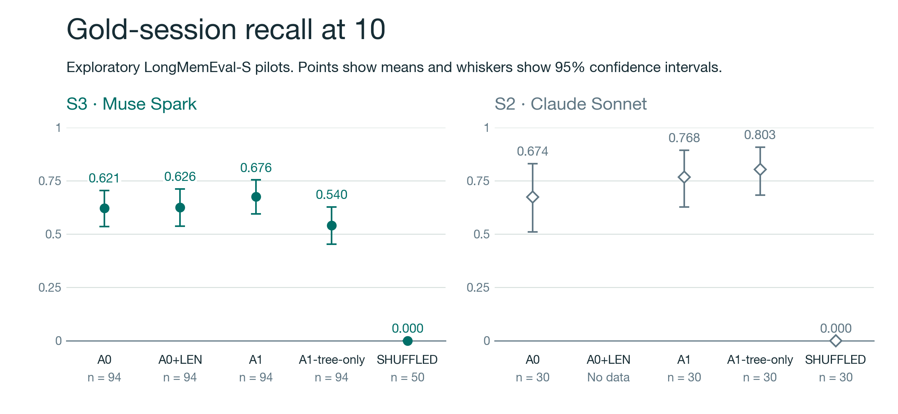

# living-context

Layered, self-reorganising long-term memory for AI agents. Memory is cut into
size-bounded leaves under a recursive tree of summary indexes. Recall is a
parallel fan-out down that tree: each index holder says which of its children
may be relevant, and the answer is a compact set of pointers with sizes, not
content. The agent then looks up only what it needs. The design adds graph
cross-links between leaves, and a feedback loop that reorganises the structure
from evidence, adopting a change only if replay shows it helps.

## Status

| | |
|---|---|
| Stage | **Experimental.** The method is **not proven**. |
| Measured | Exploratory development runs on the LongMemEval-S (cleaned) pilot split: tree recall fused with flat hybrid search (A1) against flat hybrid search alone (A0), plus controls, cost and latency. |
| Not measured | The pre-registered confirmatory run (S6-H1, 312 fresh questions) has **not happened**: its tree build stopped at call 1,536 of ~5,211 and is paused pending API credit and build-host disk space. Also not measured: H1b, H2 (cross-links), H3 (reorganisation loop), H4 (reflection/reverse audit), comparisons C1/C2, any public benchmark besides LongMemEval-S (e.g. LoCoMo), end-to-end answer accuracy, and end-to-end recall latency. |
| Claim allowed today | None about the method. The pilot shows a small recall gain that is not statistically separated from zero, at a large cost in model calls. |

Every figure below is an **exploratory development figure**, not a confirmatory
result. See [docs/RESULTS.md](docs/RESULTS.md) for provenance and the full list
of what is missing.

## How it works


Solid boxes are what the pilot measured (arms A0, A1, A1-tree-only and the
SHUFFLED control). Graph cross-links and the feedback and replay-gated
reorganisation loop are **designed and partly built, but not yet evaluated**. A
text version of the diagram is in [docs/ARCHITECTURE.md](docs/ARCHITECTURE.md).

- **Leaves.** Sessions are split into size-bounded leaves (about 4.3 leaves per
  session on the pilot data).
- **Summary tree.** Level-1 summaries cover groups of 16 leaves; upper levels
  are built recursively over those.
- **Recall.** Index holders are asked which children may be relevant. Calls
  within a tree level are designed to run concurrently; the pilot ran them
  serially within a recall. Parents return pointers and sizes. The tree list is fused with a direct flat hybrid list by
  reciprocal-rank fusion (RRF).
- **Storage.** Elasticsearch 9.5.6 (pinned image); embedder
  intfloat/multilingual-e5-small @614241f.
- **Product hardening** (on a separate line, see below): tenant isolation,
  scoped tokens, pools, erasure, keystore, versioning and a security probe
  suite.

A component-by-component walkthrough with build status is in
[docs/ARCHITECTURE.md](docs/ARCHITECTURE.md).

## Results so far

**Exploratory, pilot, n = 94.** Gold-session metrics at 10, means over 94
non-abstention questions of the 102-question LongMemEval-S pilot; model
meta/muse-spark-1.3-contributor via OpenRouter; 4,259 sessions / 18,120 leaves
pooled in one tenant; commit afd0155.

| Arm | n | Recall@10 [95% CI] | Precision@10 | All-gold@10 | MRR@10 |
|---|---|---|---|---|---|
| A0 (flat hybrid) | 94 | 0.621 [0.535, 0.705] | 0.109 | 0.521 | 0.485 |
| A0+LEN (length prior) | 94 | 0.626 [0.538, 0.712] | 0.110 | 0.532 | 0.481 |
| A1 (tree + flat, RRF) | 94 | 0.676 [0.594, 0.754] | 0.119 | 0.574 | 0.542 |
| A1-tree-only | 94 | 0.540 [0.452, 0.627] | 0.101 | 0.415 | 0.462 |
| SHUFFLED-SUMMARIES | 50 | 0.000 | 0.000 | 0.000 | 0.000 |

All-gold@10 here is over all 94 questions; the registered definition (two or
more gold sessions, n = 59) gives A0 0.441, A0+LEN 0.458, A1 0.475, tree-only
0.322.



**Honest reading.**

- A1 minus A0 is +0.054 recall@10, 95% CI [-0.009, +0.123]. **The interval
  crosses zero.** This is not evidence of an effect.
- The tree alone (A1-tree-only) **loses to flat search** (0.540 against 0.621).
  The gain of the fused list is mostly re-ranking of sessions that both lists
  already found: of the gold hits in the A1 top 10, 88 were found by both lists,
  23 by the direct list only, and 1 by the tree only. The registered
  condition (c) is technically met (1 question of 75, Wilson lower
  bound 0.002), but it is met by any single hit and says nothing; the tree alone
  supplied 1 of 112 gold hits. The condition will be tightened by an amendment
  before the confirmatory questions run.
- The negative control is weak: with summaries shuffled across nodes, recall is
  0.000, but SHUFFLED returned an empty list on 34 of the 50 questions (mean 1.3
  sessions), so A1-tree-only minus SHUFFLED (+0.538 [0.409, 0.665]) is just
  tree-only recall on those questions. The registered holder-log check was not
  run.
- **Post hoc.** A1 minus A0 is +0.126 on the 30 questions also used in the
  earlier pilot and +0.021 [-0.052, +0.096] on the other 64.
- A length explanation has not been tested. The length prior (A0+LEN) was
  fitted on these same 94 questions and changes recall on one of them, so it is
  too weak a control; the length-matched random list the plan also registers was
  not run.
- An earlier 30-question pilot on a different model (Claude Sonnet) had the
  tree alone as the best arm; on this larger pilot with a different model it is
  the worst. Model, n, pool and tree depth all changed, and the 30 questions are
  a subset of the 94, so the difference is not attributed.
- **Cost.** About 35 model calls (A1 alone averages 31.7 route calls, plus up to
  7.9 organise calls) and about $0.019 per tree recall, at a $0.10 / $0.20 per
  million token tier, and about five minutes of serial model time per recall
  (the parallel mode was not timed), against about 45 ms and zero model calls
  for flat search.
  One-time tree build for 18,120 leaves: 1,212 calls, $1.70. Total spend for
  the S3 run: $4.47 for 6,291 calls.
- Bottom line: on this pilot, A1 costs about 35 LLM calls and about five
  minutes of serial model time per recall for a +5 point recall@10 that is not statistically separated from
  zero.

The confirmatory run was pre-registered in
[docs/EXPERIMENT.md](https://github.com/ericmacdougall/living-context/blob/feat/parallel-calls/docs/EXPERIMENT.md)
on the `feat/parallel-calls` branch (first committed 2026-11-19; six dated
amendments since, including a change of model; see its section 14). Until it runs, no confirmatory claim can be
made. More detail: [docs/RESULTS.md](docs/RESULTS.md).

## Repository layout

`main` holds the licence and documentation for now; code reaches it by pull
request. Work lives on two lines of branches that `main` integrates:

| Branch | Line | Contents |
|---|---|---|
| `fix/pools-rescue` | Product hardening | Gateway, tenant isolation, scoped tokens, memory pools, erasure, keystore, versioning, verifier, security tests and probes. |
| `feat/parallel-calls` | Evaluation | Experiment harness (`evalkit/`), arms and scoring, parallel model calls, the design and pre-registration documents (`docs/DESIGN.md`, `docs/EXPERIMENT.md`). |

Design documents (on the branches above): `docs/DESIGN.md` (design of record),
`docs/EXPERIMENT.md` (pre-registration), `docs/BUILD-PLAN.md`, `docs/POOLS.md`
and `docs/ADAPTIVE.md` (amendments, designed and not adopted).

## Reproduce

The reproduction guide is `bench/README.md`, and runnable examples are in
`examples/` (arriving with the integration PR). The guide describes how to
rebuild the pilot pool and re-run the arms. Until it lands, nothing here should
be taken as reproducible by following this README alone. Contribution and test instructions: [CONTRIBUTING.md](CONTRIBUTING.md).

## License

Business Source License 1.1. See [LICENSE](LICENSE).

Free for non-commercial use, research, education and evaluation. Commercial
production use requires a commercial license from the licensor. Each version
converts to the Apache License 2.0 on its change date.

## Citation

A paper is in preparation. Until it appears, cite the repository using
[CITATION.cff](CITATION.cff). Placeholder:

```bibtex
@misc{macdougall_living_context,
  author = {MacDougall, Eric},
  title  = {living-context},
  year   = {2026},
  note   = {Version 0.1.0-dev. Paper in preparation.},
  url    = {https://github.com/ericmacdougall/living-context}
}
```
