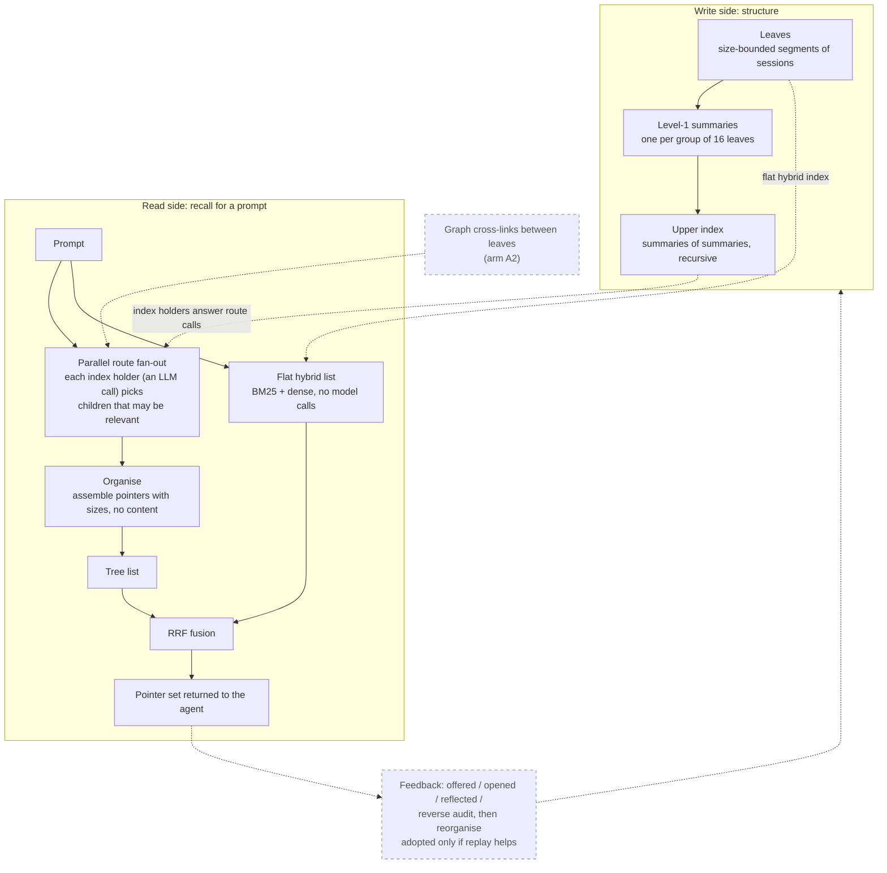

# Architecture

This is a component walkthrough of living-context with an honest status for
each part. The method is experimental and **not proven**; see
[RESULTS.md](RESULTS.md) for what has and has not been measured.

## How to read the status tags

| Tag | Meaning |
|---|---|
| BUILT+TESTED | The module exists in the code **and** the repository has unit or security tests that exercise it. It says nothing about whether the idea works. |
| BUILT | The module exists but no test in the repository exercises it directly. |
| DESIGNED | Specified in a design document; no code, or only the interfaces it needs. |

The tags were assigned by reading the modules and tests on the two branch lines
(next section), not from design intent. Run security tests through
`python tools/run_security.py`, which exits non-zero on any failure, error, skip
or empty run; under plain `unittest` a few tests skip when no cluster or model
is configured (see [CONTRIBUTING.md](../CONTRIBUTING.md)). The tags record that tests exist; they
are not a record of a fresh test run for this document.

**Built is not evaluated.** A BUILT+TESTED component can still be unmeasured.
The "Evaluated" column of the summary says whether any result in
[RESULTS.md](RESULTS.md) covers it.

## Where the code lives

`main` holds licence and documentation; code arrives by pull request from two
lines:

- **`fix/pools-rescue`: product hardening.** Gateway, policy, keystore, erasure,
  verifier, ingest, structure build and rebuild, recall, graph, feedback,
  memory pools. Its model and embedding ports run on a **deterministic stub**:
  this line tests plumbing, isolation and lifecycle, not retrieval quality.
- **`feat/parallel-calls`: evaluation.** The experiment harness (`evalkit/`):
  dataset adapter, arms and scoring, real model backends, a real embedding
  pool, staged runs, and the pre-registration documents.

The measured results come from the evaluation line.

## Diagram

The same diagram as a figure is in the [README](../README.md). Solid boxes were
measured in the pilot; dashed boxes are designed and partly built, not evaluated.

## Summary

| Component | Status | Evaluated |
|---|---|---|
| Ingest (segmentation, write path) | BUILT+TESTED | Used to build the pilot pool; not separately evaluated |
| Structure: summary tree build and rebuild | BUILT+TESTED | Build: yes (pilot, via the evaluation harness). Rebuild: no |
| Recall: parallel fan-out | BUILT+TESTED | Ranking yes (arm A1, A1-tree-only, SHUFFLED); the parallel execution was not exercised or timed in the pilot |
| Recall: flat hybrid search and RRF fusion | BUILT+TESTED | Yes (arm A0, and the fusion in A1) |
| Graph cross-links | BUILT+TESTED (on the stub) | **No** (H2 not measured) |
| Feedback: protocol log, reflection, reverse audit | BUILT+TESTED (on the stub) | **No** (H3, H4 not measured) |
| Feedback: replay gate on adopting a reorganisation | BUILT+TESTED (the gate itself) | **No** |
| Feedback: the reorganiser that proposes and applies changes | DESIGNED | **No** |
| Adaptive mode (start as plain RAG, grow into a tree) | DESIGNED | **No** |
| Policy, memory pools and tenancy | BUILT+TESTED (pools at stage 0 only) | Security tests only; no retrieval result |
| Erasure | BUILT+TESTED | Security tests only |
| Keystore | BUILT+TESTED | Security tests only |
| Verifier | BUILT+TESTED | Security tests only |
| Evalkit | BUILT+TESTED | It produced every result in RESULTS.md |

## Components

### Ingest: BUILT+TESTED

Turns sessions into leaves. Segmentation enforces a hard leaf size cap that is
never exceeded: cut at session boundaries and long time gaps, then at
embedding-similarity valleys, then (if still over the cap) at round, turn,
sentence and finally character boundaries. The write path (`ingest/writer.py`)
claims an idempotency key, allocates a source sequence number by
compare-and-set, creates a per-leaf data key, appends an encrypted source
document, and resumes the same leaf with the same ids after any failure. Titles
and subject tokens are built by code, not by a model. Modules:
`living_context/ingest/`.

### Structure and tree build: BUILT+TESTED

Maintains the summary tree over leaves: level-1 summaries over groups of leaves,
upper levels recursively. A batch rebuilder runs under a compare-and-set lease,
builds new generations by path-copying and publishes only after every build call
succeeded, so a failed call aborts the whole generation. A write-path watermark
makes a write visible to the builder only after the relevant indices have been
refreshed. Retention, placement and publication of structure versions are
separate modules. Modules: `living_context/structure/`. The pilot built its tree
with the evaluation harness against a real model, not through this stub-backed
rebuilder.

### Recall fan-out: BUILT+TESTED

The owner's read path: every top-level index holder of the pinned structure
generation is asked in parallel which children may be relevant; each named
child that is itself a node becomes a new holder call as soon as its parent
answers, bounded by a holder budget. A holder is one stateless model call over a
bounded number of child entries. Outputs are validated against the presented
labels, and a failed call falls back to embedding routing and is flagged. The
parent merges pointers and sums sizes in code, and an "organise" step assembles
the pointer set. What leaves is a pointer contract (ids, sizes, paths), not
content. A reader of several access classes gets one digest per class, merged by
reciprocal rank. Organise output shapes the outline only; it does not change the
ranked list. The embedding fallback uses the stub embedder. Modules:
`living_context/recall/` (`fanout.py`, `entry.py`, `digest.py`, `lookup.py`,
`view.py`).

### Flat hybrid search and fusion: BUILT+TESTED

`recall/direct.py` runs BM25 and dense kNN over leaves (no model calls);
`recall/fusion.py` implements reciprocal-rank fusion. In the evaluation line the
same pieces define arm A0 and the fused arm A1.

### Graph cross-links: BUILT+TESTED, not evaluated

Typed, weighted edges between leaves, so that distance in the tree is not
isolation. An edge lives in the index of the join of its endpoints' access
classes, so a reader who cannot see one endpoint cannot see the edge.
Expansion from a digest is bounded in hops, neighbours per node and expanded
leaves per recall; expanded leaves appear in a separate `linked` section with
their path. This is a minimal producer driven by the stub. Decay, hub handling
and personalised ranking are designed for later. The H2 hypothesis (cross-links
help on multi-session questions) has **not been measured**. Modules:
`living_context/graph/`.

### Feedback: BUILT+TESTED on the stub, loop not evaluated

Built pieces:

- **Protocol log**: one row per offered item per recall, plus the stored query;
  "opened" is written by the gateway side when a lookup serves a leaf, never by
  the agent's own claim.
- **Reflection**: a separate judge pass that decides afterwards what was
  relevant.
- **Reverse audit**: at pruning time, asks which past searches a leaf should
  have answered and whether the tree offered it; flags leaves for re-filing.
- **Replay gate**: decides whether a candidate reorganisation is adopted by
  replaying past queries against current and candidate structures.
- **Exploration** and judge helpers.

**DESIGNED, not built:** the reorganiser that turns this evidence into candidate
structure changes and applies an adopted one. The whole loop (H3, H4) has **not
been measured**. Modules: `living_context/feedback/`.

### Adaptive mode: DESIGNED

A pool should start as plain fast RAG and grow a tree only when size and
complexity demand it. This is specified in `docs/ADAPTIVE.md` (an amendment, not
adopted). The product line builds only the first layout ("stage 0") of a pool.

### Policy, memory pools and tenancy: BUILT+TESTED

A pure admission decision function (`policy/decide.py`) that fails closed,
access classes and roles, and memory pools: named collections a session is
granted, each belonging to one access class, with scoped tokens and per-tenant
monotone grant counters. The gateway (`living_context/gateway/`) enforces
tenant isolation, scoped-token authorization, revocation on a bounded epoch
journal that fails closed, per-tenant send fences and agent tools
(`pool_save`, `pool_update`, `pool_query`, `pool_fetch`) that authorize every
pool they name before touching an index. Pools are built at stage 0 only. A
security probe suite lives under `tools/probes/`.

### Erasure: BUILT+TESTED

Erasure computes the lineage closure of a subject, writes a tombstone to a
hash-chained journal before anything is destroyed, destroys the keys, deletes
the closure's documents, and rewrites affected structure nodes to
placeholders. Pool delete is an erasure of scope `pool`. Known limits
(filesystem blocks, flash wear levelling) are listed in `docs/DESIGN.md`.
Modules: `living_context/erasure/`.

### Keystore: BUILT+TESTED

One SQLite file per tenant, secure delete on, checkpoint after every destroy
batch. AES-256-GCM data keys per leaf version and per-tenant HMAC keys for
subject and principal tokens. Destroying a key is how erasure makes ciphertext
unrecoverable. Modules: `living_context/keystore/`.

### Verifier: BUILT+TESTED

An independent check that an erasure really removed everything. It is written
to share no code with the executor and reads every index through its own
read-only credential. Planted canaries (short and long strings, vectors,
subject tokens, log lines) must be found by a positive control before the
absence check means anything. Modules: `living_context/verifier/`.

### Evalkit: BUILT+TESTED

The experiment harness on the evaluation line: dataset adapter and split code,
the arms (A0, A0+LEN, A1, A1-tree-only, SHUFFLED) and their scoring, clustered
bootstrap statistics, call budgets, parallel model calls, a real embedding pool
and staged runners (S2, S3, the S6-H1 confirmatory runner). Runs write call
ledgers; every figure in RESULTS.md was recomputed from them. Modules:
`evalkit/`.

## Design documents

Design of record, pre-registration and amendments are on the branches above:
`docs/DESIGN.md`, `docs/EXPERIMENT.md`, `docs/BUILD-PLAN.md`, `docs/POOLS.md`,
`docs/ADAPTIVE.md`. Their own text says what each has and has not run.
